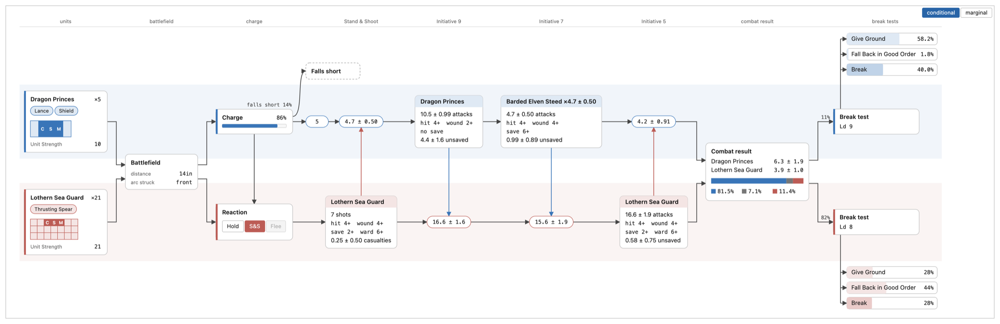
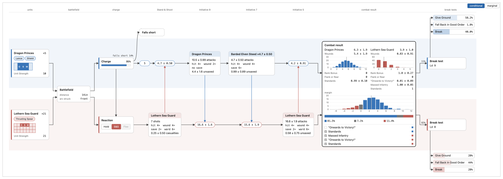

# Avelorn

Avelorn is a toolkit for **Warhammer: The Old World**. It combines a curated rules corpus, exact combat mathematics, and a browser for exploring units, armies, and battles.

The goal is not to estimate a result from thousands of simulated games. Avelorn carries the exact distribution of possible outcomes forward, preserving the branches that matter: casualties, failed tests, charge reactions, combat results, and player choices.

## What is this vibe coded bullshit?

I am a big fan of writing clean and concise code. LLMs have proven to help me massively at work, but they definitely don't produce the best code on the first try without steering; maybe that will change in the future.

This project is an attempt to write code for what I know to be a very hard endeavour - mapping a game with hooks and rules that interact with each other - using only LLMs. As of now, the only piece of the codebase I have touched by hand is this README, and even then just the parts until now.

I believe that in order for me to get better at using LLMs, a project such as this - forcing me to wrestle with their inherent weaknesses - will massively help. I hope to become better at planning before prompting and properly steering these models.

The tooling used so far is Claude Code + Claude Opus 4.8 and Claude Fable 5. If you're going to dive into this project, thanks for sticking it out so far! The fun part begins now.

## A charge, all the way down



Five Dragon Princes charge twenty-one Lothern Sea Guard, seven wide. The Sea Guard stand and shoot, the Charge roll decides whether the princes arrive, riders, steeds and spears strike in Initiative order, and two Break tests close the round. Every number on it is an exact distribution.

## Open any step



A node opens to its distribution, the parts that add up to it and the rules that touched it. Change the distance, the reaction or either unit, and the whole fight follows.

## Run it

```sh
make up
```

Then open [localhost:5173/table](http://localhost:5173/table), deploy two units, drag one onto the other and open the graph. Without containers, run `make serve` and `make frontend` side by side; `make install`, `make test` and `make lint` cover development.

## Data and credits

Unit data is imported from [tow.whfb.app](https://tow.whfb.app), an excellent community reference for The Old World. Thanks to its author, **@FlammableHero**, for building and maintaining it.
